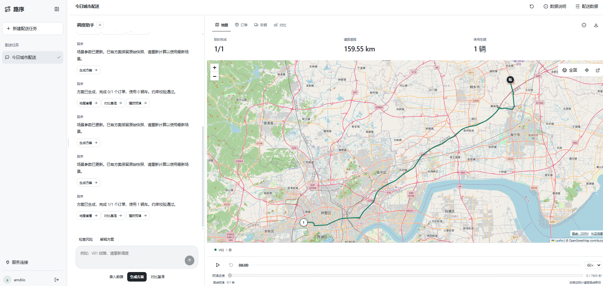
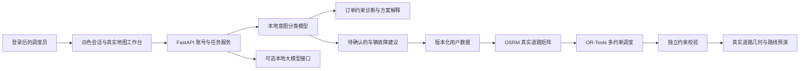

# 路序 · 城市配送智能调度

面向城市无人配送车调度员的可运行原型：将用户录入的订单与车辆、公开真实道路、本地 AI 调度助手和多约束优化组合起来，生成可校验的配送方案，并支持基准对比、车辆故障重调度和路线预演。Python FastAPI 后端，React / TypeScript 前端。

当前包含全国地图视野、注册登录、字段说明、可拖动栏宽及可暂停、跳转和重播的路线预演。全国地图视野不代表已验证全国所有配送地点或无人车道路通行许可。

参赛方向：AI + 物流赛道，城市配送智能配载 / AI 驱动的无人配送车辆智能调度。材料依据：[官方提交与评审说明](http://asserts.dsdigital.team/static/transfar/transfar-dsgroup-ai-architect-hackathon.html#/guide)。提交前的待办见 [提交检查表](docs/SUBMISSION.md)。

## 团队信息：风的残差

| 项目 | 内容 |
|---|---|
| 参赛形式 | 团队参赛 |
| 团队名称 | 风的残差 |
| 团队成员 | 刘乙剑、刘浩宇、郭子扬、许楚晗、孙道岩 |
| 背景介绍 | 来自东北大学与东北财经大学，覆盖软件工程、大数据管理与应用、财务管理、会计学及经济统计学，结合软件与 AI 实践、数据分析、业务研究及材料组织经验开展协作。 |
| 提交仓库 | [amdilo2025/AI_Architecture_Competition](https://github.com/amdilo2025/AI_Architecture_Competition)（私有仓库） |

成员介绍依据本人自述及团队提供的资料整理；既往科研与竞赛经历不等同于本项目的验证成果。代码由 Codex 辅助实现，需求、示例参数、结果确认和正式提交由参赛团队参与完成。

### 成员与分工

| 成员 | 学校 / 专业 | 主要分工 |
|---|---|---|
| 刘乙剑 | 东北大学 · 软件工程 · 2024 级本科生 | 项目需求梳理、迭代协调与演示组织。 |
| 刘浩宇 | 东北财经大学 · 大数据管理与应用 · 2024 级本科生 | 代码修改、前后端框架搭建、需求与设计文档修改。 |
| 郭子扬 | 东北财经大学 · 财务管理 · 2023 级本科生 | 需求与设计文档编制、梳理和归档，衔接业务需求与技术方案。 |
| 许楚晗 | 东北财经大学 · 会计学 · 2025 级本科生 | 市场与产业资料调研、商业方案财务与数据部分、作品材料整理及进度跟进。 |
| 孙道岩 | 东北财经大学 · 经济统计学 · 2025 级本科生 | 选题分析与方案思路撰写。 |

### 成员背景与相关经历

**刘乙剑**：东北大学软件工程 2024 级本科生，绩点排名 47/287。RAG 方向专利 1 项，当前待公开；获东北大学优秀学生干部、校二等奖学金与三等奖学金。大学生数学竞赛省二等奖、全国大学生数学建模竞赛省三等奖、美国大学生数学建模竞赛成绩 S。参加华为 CANN 算子训练营、算子天梯赛及挑战赛，通过大学英语六级。担任东北大学校团委青年新媒体中心主任，具有新媒体运营经历。完整个人简历见 [刘乙剑简历](docs/resumes/刘乙剑.md)。

**刘浩宇**：东北财经大学大数据管理与应用专业本科生，绩点排名 5/63，大学英语六级 532 分，计算机四级数据库工程师。获校三好学生、学科竞赛先进个人及校一、二、三等奖学金各一次。成员资料列示全国大学生数学竞赛一等奖、东方财富杯全国大学生金融挑战赛二等奖、大学生数据要素素质大赛二等奖、华数杯与数维杯数学建模竞赛三等奖，以及蓝桥杯省二等奖、MathorCup 省一等奖等经历。参与学校数据分析协会，使用 Python、Lingo、Git 等工具开展数据分析与建模。

**郭子扬**：东北财经大学财务管理专业本科生，绩点与综合排名均为 1/78，均分 93.77/100；成员资料记载已获得推免资格，推免至南开大学金融硕士。参与企业漂绿与债务融资成本、债券违约风险与审计披露等机器学习和文本分析研究，以及“沪深港通”交易机制与企业避税国家级大创项目。竞赛经历包括 MPAcc 学生案例大赛国家一等奖、全国企业竞争模拟大赛国家二等奖，以及数学建模、数字物流与供应链等相关竞赛。使用 Python、Stata、ArcGIS、Axure 及金融数据库开展研究和文档工作。

**许楚晗**：东北财经大学会计学专业本科生，综合测评排名专业前 3%，参评学年专业排名前 20%。获校级三等奖学金、挑战杯校级一等奖与三等奖、永达杯校级一等奖并推荐至省赛，具有计算机二级证书。担任学生会校友工作部副部长与班级文艺委员，具有活动组织、协调及材料整理经验，使用 Excel、PPT、Word 开展财务数据和作品材料工作。

**孙道岩**：东北财经大学经济统计学专业本科生，大学英语四级 505 分，计算机二级。成员资料列示全国大学生英语翻译大赛省三等奖、大连市大学生数学竞赛一等奖、红石榴杯创新创业计划邀请赛银奖、辽宁省数学建模省二等奖，以及华数杯、数维杯数学建模竞赛国家三等奖。参与市场调查与分析协会，学习经济统计、计量经济学、多元统计与时间序列等课程，使用 R、SPSS、SAS 进行数据处理和分析。

详细成员履历与项目分工见 [团队成员资料](docs/TEAM.md)。

## 界面展示与 Demo 视频



上图为团队提供的应用运行截图，展示调度对话、真实道路地图、配送路线和预演控制。图中的 1/1 订单、159.55 km 和 1 辆车属于该次输入与方案的界面记录，不作为通用性能或成本改善结论。地图来源为 OpenStreetMap / OSRM。

### Demo 演示视频（网盘链接预留）

| 项目 | 内容 |
|---|---|
| 网盘分享链接 | 待补充：上传演示视频后填写真实分享链接。 |
| 提取码 | 待补充；无需提取码时注明“无需提取码”。 |
| 视频文件名 / 格式 | 待补充。 |
| 链接有效期 | 待补充；应覆盖整个评审期间。 |
| 访问方式 | 打开分享链接，按需输入提取码，在线观看或下载视频。 |
| 建议展示内容 | 注册登录 → 录入数据 → 加载真实道路 → 生成方案 → 地图查看 → 对比基准 → 播放预演 → AI 风险分析 / 故障重调度。 |

当前尚未填写视频分享链接。可先按 [五分钟本地演示步骤](docs/DEMO.md) 复现；视频链接填写后需检查访问权限、提取码与有效期。

## 业务场景与应用价值

目标用户是城市配送站的调度员，日常需要为多辆配送车分配有重量、收货窗口和交付耗时要求的订单。单纯按距离就近分配容易忽略载重、返站续航或时间窗口；车辆临时故障后，还需要重新判断剩余运力。

本项目将调度过程组织为“录入数据 → 获取真实道路 → 诊断约束 → 生成方案 → 地图检查 → 对比基准 → 路线预演”。输出包含车辆与订单的对应关系、交付顺序、道路里程、预计完成时间、估算费用及未分配原因，支持调度员审核方案后开展下一步业务操作。

已验证的是原型流程、约束校验和体验案例的可运行性。预期价值是减少人工排程与重复检查，提高运力安排的可解释性，并在同一数据口径下比较方案。尚未开展企业真实订单试点，不能据此宣称已降低实际配送成本、减少空驶率或达到某个效率提升百分比。

## 启动

已安装依赖的当前项目：在项目根目录执行 `powershell -ExecutionPolicy Bypass -File .\start.ps1`，打开 http://127.0.0.1:8080 。API 文档：http://127.0.0.1:8080/docs 。

重复执行启动命令时，脚本检查已有服务；如果是正常运行的路序服务，会显示访问地址并直接退出，无需重复启动。手动启动的新服务需要保留终端窗口；关闭窗口或按 Ctrl+C 会停止该服务。

首次安装：Python 3.12、Node.js 20+，执行 `powershell -ExecutionPolicy Bypass -File .\setup.ps1` 后启动。脚本优先使用正常 Python，也支持 `DISPATCH_PYTHON` 指定实际 Python 路径。前端预构建产物已包含在压缩包中；Python 依赖按 requirements.lock.txt 安装。免费开发依赖，不要求付费大模型 API。

### 评委首次复现（Windows / PowerShell）

1. 克隆已获得访问权限的私有仓库，或在 [Release v2.0.0](https://github.com/amdilo2025/AI_Architecture_Competition/releases/tag/v2.0.0) 的 Assets 下载“路序-城市配送调度-完整项目.zip”并解压到本机。

   ```powershell
   git clone https://github.com/amdilo2025/AI_Architecture_Competition.git
   Set-Location AI_Architecture_Competition
   ```

2. 安装 Python 3.12 和 Node.js 20+，在项目根目录打开 PowerShell。
3. 执行下列命令。首次安装需要联网下载依赖；地点搜索、道路规划和地图展示也依赖联网。

```powershell
powershell -ExecutionPolicy Bypass -File .\setup.ps1
powershell -ExecutionPolicy Bypass -File .\start.ps1
```

4. 打开 <http://127.0.0.1:8080/>，注册自己的账号，按 [五分钟演示步骤](docs/DEMO.md) 体验。
5. 使用完毕，在运行服务的终端按 Ctrl+C 停止。关闭网页只关闭界面，不会停止后端。

当前验证环境是 Windows、Python 3.12、Microsoft Edge；其他操作系统尚未验证。`setup.ps1` 会安装前后端依赖并重新构建前端；Git 默认忽略 `frontend/dist/`，因此通过源码仓库复现时不能省略构建。项目压缩包另含预构建前端。

Release v2.0.0 为已发布版本快照；最新团队介绍、个人简历与演示截图以 `main` 分支材料为准。

`127.0.0.1` 是评委各自电脑上的地址，不是在线 Demo 链接。当前未提供公网 Demo，也不要求评委配置付费大模型 API。

### 常见问题

| 现象 | 处理方式 |
|---|---|
| 8080 端口被占用 | 重复启动自己的正常服务会提示访问地址；若其他程序占用了端口，先确认占用程序，再选择关闭它或配置其他端口，不能随意结束进程。 |
| 浏览器无法连接 | 确认启动窗口仍在运行，访问地址是 `http://127.0.0.1:8080/`。 |
| 提示前端未构建 / Python 依赖缺失 | 先执行 `setup.ps1`，确认没有安装失败提示，再执行 `start.ps1`。 |
| 无法搜索地点或加载道路 | 检查网络和公共服务是否可用，保留输入后重试；不会自动改用虚构道路。 |
| 字段超限 | 按字段旁的提示修改。费用输入单位是元，API 费用单位是分；例如出车费最大 10000 元。 |
| 方案没有可播放车辆 | 检查未分配原因，修正实际载重、往返续航、时间窗口或车辆可用状态；空路线不能播放。 |

需要改端口时可在项目根目录执行 `$env:PORT='8082'` 和 `$env:PUBLIC_APP_URL='http://127.0.0.1:8082'`，然后启动；两个变量需要与实际访问地址保持一致。

## 使用流程

1. 创建账号并登录。用户名3～40位，密码10～128位。任务按账号隔离。
2. 新建配送任务，打开“配送数据”。选择实际配送站、出发日期、时间和工作时长。
3. 地点可通过公共地点搜索、点击真实地图或输入 WGS84 经纬度选择。填写地点名称与地址补充。
4. 逐笔录入订单编号、重量、收货窗口和交付耗时；逐辆录入车辆编号、载重、续航与计费参数。每次点击“添加订单”或“添加车辆”才能加入待保存列表；列表可编辑、移除、停用车辆。
5. 点击“加载真实道路”，从 OSRM 获取实际道路距离与静态行驶时间矩阵。无可用道路时明确失败，保留输入，允许重试。
6. 生成方案、地图查看、对比基准、播放路线预演。路线沿 OSRM 返回的完整道路几何显示，包含返站。默认60倍速，可调整倍速、暂停、跳转进度、重置与完成后重播。没有已分配订单的方案会显示具体未分配原因，不能播放空路线。

桌面拖动任务栏与对话栏右侧的分隔线调整宽度；聚焦分隔线后，方向键微调，Shift加方向键每次调整50px，双击或Enter恢复该栏。顶部“恢复默认栏宽”重置两栏。栏宽按账号在当前浏览器保存；手机采用标签切换，不显示拖动线。顶部“数据说明”和编辑器“字段说明与填写示例”解释单位、范围、费用计算与结果口径。

**空账号没有预置业务数据。** 订单和车辆来自用户输入；地图与道路来自 OpenStreetMap / OSRM，公共地点来自 Photon。地图初始视野为全国，可搜索各城市或输入 WGS84 坐标。有配送数据时自动定位配送范围；“全国”按钮返回全国，“查看全部配送点”定位当前任务。

首次体验可按 [可录入体验数据](docs/可录入体验数据.md) 手动填写。3 个公开道路坐标已核实，订单与车辆参数是明确标注的体验参数；实际求解完成 2/2 单，道路里程约 4.82 km。对应 API 请求体见 docs/example-input.json。

最多50笔订单、15辆车辆。收货时间相对于出发时间，均采用北京时间；当前编辑器支持同日时间窗口。每单重量精确到克，车辆续航包含返站。费用输入为0时不计算业务费用，但路线仍以道路里程作为优化目标。

车辆载重范围 0.001～500 kg，续航大于 0 且不超过 500 km；界面出车费用范围 0～10000 元，每公里费用范围 0～1000 元。出车费用指每次出车的费用，不是购车价格。超限输入在字段旁显示具体错误并保留内容。

## AI 功能与架构



- 本地意图模型：scikit-learn 字符 TF-IDF + LogisticRegression。训练语料位于 backend/ai.py，7类意图、264条带前缀的训练文本，在本机训练与推理。它是有限领域分类器，不是通用大模型。
- “分析订单风险”：依据真实道路、重量、续航和收货窗口检查单订单可行性、时间余量及总载重缺口。
- “解释当前方案”：根据已计算路线与实际指标解释分配顺序，不编造改善百分比。
- “V01 故障，请重新调度”：识别已有车辆编号，生成停用建议；点击应用后更新版本，保留订单与道路，再重新求解。至少保留一辆可用车辆。
- “生成配送方案”“对比基准”“播放配送预演”：分类后提供对应可执行按钮。
- 可选大模型：OpenAI-compatible HTTP 协议，可连接免费的本地模型服务。模型只产生受校验的说明与停用建议，不执行任意代码，不直接控制车辆。

求解采用 CVRPTW、Parallel Cheapest Insertion 和 Guided Local Search。目标：完成更多订单，降低按录入参数估算的费用，然后降低道路里程。独立重算检查订单唯一性、道路可达性、交付窗口、载重、返程续航和结果一致性。有限预算内不保证全局最优。

### AI 与业务工具的分工

| 层次 | 实际实现 | 作用 |
|---|---|---|
| 语言理解 | `backend/ai.py`，本地字符 TF-IDF + LogisticRegression | 将输入识别为规划、对比、风险、解释、故障、预演或帮助意图。 |
| 事实诊断与解释 | 已录入订单、车辆、道路和已计算方案 | 生成基于当前数据的风险说明与方案解释，不编造实时交通信息。 |
| 规划工具 | `backend/optimizer.py`，OR-Tools | 在载重、续航、时间窗口和工作时长约束下求解；路线由求解器计算。 |
| 执行控制 | `backend/main.py`，作业、版本快照及待确认建议 | 控制计算状态和数据版本；用户确认故障建议后再更新数据、重新求解。 |
| 输出校验 | 独立重算约束与指标 | 核对订单唯一性、载重、时间及返程里程，再展示结果。 |
| 扩展接口 | `backend/integrations.py` | 预留大模型、地图和车辆平台的服务端调用适配。 |

本项目的 AI 架构是语言理解、业务事实、受控工具调用和结果校验之间的协作。默认启用的是小型本地分类模型；多约束调度属于运筹优化。尚未接入通用大模型或真实车辆遥测，也没有把预留接口宣称为已落地集成。264 条训练文本包含人工编写短句和前缀扩展，功能测试不等于正式模型泛化评测；当前没有发布独立测试集准确率。

## 地图与真实道路

前端 [Leaflet](https://leafletjs.com/)；地图 [OpenStreetMap](https://www.openstreetmap.org/)；公共地点 [Photon](https://github.com/komoot/photon)；真实道路 [OSRM](https://project-osrm.org/)。地图中可直接打开外部真实地图、打开收货点、纠正地图数据。

路线是非对称道路矩阵与实际 LineString，不是矩形格网、直线连点或装饰性曲线。生成方案后逐段取得道路几何，并核对其里程、时间与矩阵一致。道路服务异常时不会切换模拟图。

公开服务仅用于适量交互使用。后端全局串行限速≤1请求/秒，缓存24小时；地点搜索只在用户点击搜索时请求，禁用自动扫描。前端显示归属与来源。自动化浏览器测试拦截公共地图瓦片，避免对瓦片服务产生批量负载。

限制：OSRM 默认驾车配置与静态速度不等于无人车专属通行能力，也不包含实时拥堵。真实无人车限速、禁行区、车道许可、遥测和任务下发需车辆/地图平台提供。路线预演按道路长度和预计时间插值，不代表实时车辆运动；未控制真实车辆。

## 账号与数据

SQLite 记录账号、任务、消息、版本化数据、方案和作业。密码使用独立盐 scrypt；会话为随机不可预测令牌，数据库仅保存令牌摘要。HttpOnly / SameSite cookie，7天有效，退出使会话失效；跨账号的任务或方案 ID 请求返回404。旧版无归属任务不会自动分配给新注册账号。

默认仅监听127.0.0.1。若部署到服务器，应设置 HTTPS、`COOKIE_SECURE=true`、`PUBLIC_APP_URL`，并为公开服务切换自建或合适供应商。当前登录没有邮箱验证、短信验证码或找回密码流程。

订单与车辆留在应用数据库；公共地点查询与配送坐标会发送至配置的地图/道路服务。用户可将真实客户数据保存在本地，只对公共建筑、道路入口等地点做搜索；企业部署可自建服务。密码、令牌和 API 密钥不会发送到地图服务。可选大模型只在配置后接收调度上下文。

## 配置与接口

复制 .env.example 到 .env。服务端设置 OSRM_BASE_URL、PHOTON_BASE_URL、MAP_TILE_URL 可切换服务；LLM_BASE_URL、LLM_MODEL 配置本地模型；VEHICLE_BASE_URL 保留车辆网关能力。见 [接入文档](docs/INTEGRATIONS.md) 与 [API](API.md)。

源代码：backend/main.py 服务、backend/auth.py 登录权限、backend/roads.py 真实地图道路、backend/ai.py AI、backend/optimizer.py 求解、frontend/src/App.tsx 工作台、ScenarioEditor.tsx 录入、RoadMap.tsx 地图、AuthScreen.tsx 登录。

## 验证

```powershell
.\.venv\Scripts\python.exe -m pytest tests -q --basetemp .tmp\pytest-release --junitxml artifacts\backend-tests.xml
npm.cmd --prefix frontend run build
npm.cmd --prefix frontend run test:e2e
npm.cmd --prefix frontend run test:a11y
```

后端测试包含账号隔离、会话注销、跨来源拒绝、版本冲突、重复请求、取消、道路缓存、方向差异、克级重量、独立路线校验、本地AI未见语句、模型输出白名单、真实服务错误不降级模拟图。测试中的隔离 MockTransport 数据只用于测试，不是应用案例。

本次验证：26项后端测试；浏览器覆盖全国地图、栏宽拖动与键盘调整、宽度持久化、字段说明、真实道路车辆移动、预演进度跳转与重播，以及不可行方案的播放拦截。具体通过状态见 artifacts/verification.json。严格设计审查与设计文档lint记录见 artifacts。后端另覆盖导入不干扰正在运行的计算，以及服务启动恢复中断作业。实际公开服务检查记录见 artifacts/real-services.json：3个公开道路坐标的非对称矩阵、逐段完整道路形状与公共地点查询。第三方测试工具仍有弃用提示，见测试输出。

浏览器测试自动启动8081端口的独立服务，每次使用新测试数据库，只复用公开道路缓存；不会写入工作台的账号或任务。当前4项完整浏览器测试和1项独立无障碍测试通过。

真实服务检查只验证真实道路与坐标返回，不将开发验收订单宣称真实运营订单。业务优化效果应在用户录入业务数据后重新测量；第一版模拟场景的29.7%指标不作为本版效果。

### 可核查的结果与评价边界

以下结果来自仓库内保存的开发验收记录；本次 README 更新没有重新运行整套测试。

| 检查 | 保存的结果 | 证据 |
|---|---|---|
| 后端功能与约束 | 26 项通过 | [JUnit 记录](artifacts/backend-tests.xml) |
| 浏览器完整流程 | 4 项通过，0 项失败 | [浏览器记录](artifacts/browser-tests.json) |
| 独立无障碍流程 | 1 项通过，状态见汇总 | [验证汇总](artifacts/verification.json) |
| 前端构建 | TypeScript 检查和 Vite 构建通过 | [验证汇总](artifacts/verification.json) |
| 公开地图与道路 | 方向性道路矩阵、完整路线几何和地点查询已检查 | [真实服务记录](artifacts/real-services.json) |
| 杭州体验案例 | 完成 2/2 单，使用 1 辆车，道路里程 4.821 km，参数估算费用 35.79 元 | [案例结果](artifacts/example-validation.json) |

体验案例的业务参数由人工设定，仅道路来自公共真实服务；它验证流程与约束，不代表真实运营效果。上述 35.79 元来自录入的计费公式，不是企业实际结算费用。

基准方法是满足相同硬约束的就近贪心分配；优化方法是 OR-Tools 多约束求解。页面“对比基准”会对同一版本的数据分别计算，显示完成量、里程、车辆数、费用和耗时。完成订单数量不同的时候，不直接给出成本节约比例。当前尚未提交具有代表性的多任务业务对比报告或规模压测报告；提交者可补充已确认输入及对应输出，明确数据性质，不编造优势。

若需重新运行浏览器测试，当前配置使用 Microsoft Edge，需先安装 Edge；运行完整无障碍场景后再单独运行 `test:a11y` 属于可选复核。pytest 与浏览器测试使用隔离数据库；浏览器测试占用 8081 端口。测试用模拟道路仅用于隔离回归测试，不作为应用业务案例。

## 工程规模与企业落地路径

当前是单机部署原型：单任务最多 50 笔订单、15 辆车辆；SQLite 保存业务状态，后台最多 2 个计算线程。应用代码和本地分类模型在本机运行，地图瓦片、地点查询和道路矩阵使用公共网络服务。未验证大量并发用户，也未给出最低硬件配置或吞吐量承诺。

主要瓶颈是配送点数量增加时道路矩阵的平方增长、多约束搜索耗时、SQLite 并发写入和公共地图服务的限流。全国视野属于地图导航能力，不能视为跨省大车队调度规模验收。

后续扩展可将计算转为独立队列与工作进程、将状态存储迁移到 PostgreSQL，并接入自建或合同允许使用的道路与地点服务。订单量进一步增大时，先按配送站和区域分组，再进行滚动重调度；这些属于计划，当前版本尚未实现。

企业试点建议先获取已授权、脱敏的实际订单与车辆参数，在同一批数据上与人工排程或现有规则比较完成率、逾期率、里程、出车数和调度耗时。之后接入车辆位置、剩余电量、禁行区域和无人车通行规则，并由调度员审核方案。只有通过平台验收后，才扩展到真实任务下发；本版路线预演不会控制真实车辆。

原型运行不需要付费大模型调用。实际部署成本包括计算与存储、网络、道路服务、车辆平台对接和维护；当前没有可靠业务规模依据，尚未提供企业费用报价。真实运营还需要 HTTPS、备份、权限治理、日志监控和供应商服务保障。

## 参赛提交

参赛仓库：[amdilo2025/AI_Architecture_Competition](https://github.com/amdilo2025/AI_Architecture_Competition)。仓库已确认为私有，官方账号 `DsChHack` 的仓库写入权限已核验（2026-10-11）。源码、运行说明与支撑材料位于 `main` 分支；包含预构建前端的“路序-城市配送调度-完整项目.zip”通过 [Release v2.0.0](https://github.com/amdilo2025/AI_Architecture_Competition/releases/tag/v2.0.0) 的 Assets 下载，不放在 `main` 文件列表中。Release 下载需要仓库访问权限。

团队和成员资料已补充，参赛者仍需核对履历与最终分工，并通过赛事指定渠道提交上述仓库链接；上传到 GitHub 不等于完成赛事渠道提交。当前未核验正式提交回执。

必须交付的是可访问的私有仓库链接，ZIP 只是整理和转移材料的便利方式。提交前请核对团队信息，保持仓库私有及 `DsChHack` 评审权限，并完成赛事指定渠道提交。个人简历和成员履历已提供；当前没有公网 Demo 或视频分享链接，视频网盘字段在上方预留。

提供源码仓库时，保留 `requirements.lock.txt`、`frontend/package-lock.json`、安装脚本、文档和验收记录；排除 `.venv/`、`node_modules/`、`.env`、运行数据库与私人业务数据。Git 默认不提交前端构建产物，安装脚本会重新生成；ZIP 则包含预构建前端。截图 [工作台](artifacts/workbench-v2.png)、[登录页](artifacts/login-v2.png)、[移动界面](artifacts/mobile-v2.png) 是较早版本的开发记录，当前全国地图和可调栏宽以实际运行界面为准。

### 数据、开源与人工环节说明

- 业务订单与车辆：用户自行录入。体验文档中的订单、车辆和地点标签是人工设定参数；不声称真实企业订单或客户。
- 真实道路与地点：OpenStreetMap / OSRM / Photon；地图保留来源署名，公共服务存在限流与不可用风险。当前道路时间为静态估算。
- 人工操作：地点选择与核对、订单车辆录入、故障建议确认、结果审核、团队信息填写及正式提交。系统没有自动从企业系统取得完整业务数据。
- AI 辅助开发：Codex 参与代码和文档实现；本地分类语料为代码中的人工短句及扩展，不使用赛事保密数据训练。
- 第三方组件：Python 使用 FastAPI、Uvicorn、Pydantic、HTTPX、OR-Tools、scikit-learn 等；前端使用 React、TypeScript、Vite、Leaflet、Lucide；测试使用 pytest、Playwright 和 axe。锁文件记录具体版本，提交者应保留相关开源许可与来源说明。
- 当前不包含赛事方提供的保密业务数据。若后续获授权数据，应遵守赛事规定，不未经许可上传到公共服务、外部模型或仓库。

官网提交说明载有作品知识产权归属条款，提交者应阅读并确认其适用要求。该说明不替代参赛者对作品来源、使用权及正式提交的确认。

代码由 Codex 辅助实现。第三方库遵循各自开源许可；OpenStreetMap 数据为 ODbL，Leaflet 为 BSD-2-Clause，Photon 为 Apache-2.0，OSRM 为 BSD-2-Clause。提交前请核对比赛的作品与知识产权条款。
